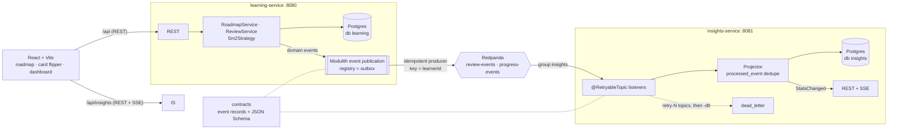

# Study Forge

**Learning roadmaps and spaced-repetition review, with progress analytics streamed over Kafka.**

Break something you want to learn into a roadmap (stages, then items with an estimated time), attach flash cards,
and review what is due today. Each review is graded 0–5 and rescheduled with SM-2. Every review and every
completed item becomes an event; a separate insights service turns that stream into your streak, a retention
curve, weekly study minutes and a forecast of how many cards fall due in the coming days, pushed live to the
dashboard.

Java 25 · Spring Boot 4.2 · Spring Kafka (Redpanda) · Spring Modulith outbox · Postgres + Flyway · Spring Data JDBC ·
Actuator/Micrometer/OpenTelemetry · springdoc OpenAPI · React + Vite + TypeScript.

> Screenshot coming. All data in the app, tests and seeds is synthetic.

## What it does

- **Roadmaps** – a roadmap has stages, a stage has items with estimated minutes; completing an item updates
  roadmap progress and emits `ItemCompleted`.
- **Cards and review** – cards hang off a roadmap (optionally an item). "Review now" lists the cards due today
  in the learner's own time zone; the web card flipper shows the front, flips, and offers grade buttons 0–5.
- **SM-2 scheduling** – behind a `SchedulingStrategy` interface so FSRS can be added later (ADR 0004).
- **Insights** – streak (consecutive learner-local days with a review), retention by interval bucket, minutes per
  day for the last week, due-card forecast, total reviews; REST plus a Server-Sent Events stream that pushes
  fresh stats after every applied event.
- **Dead letters** – events that could not be applied are parked and listed at `GET /api/insights/dead-letters`.

## Architecture

Two deployables in one Maven reactor, a deliberately small microservices example (ADR 0003). The write side
owns learning data; the read side owns projections; they share only the event contracts.



```
contracts/         ReviewRecorded, ItemCompleted, Topics + JSON Schemas and a schema contract test
learning-service/  domain (Roadmap, Card, CardSchedule, Grade, SchedulingStrategy, Sm2Strategy)
                   application (RoadmapService, ReviewService, ports) · adapter/ persistence (Spring Data JDBC)
                   · messaging (outbox externalization to Kafka) · web (REST, problem details)
insights-service/  domain (LearnerStats, Streak, RetentionBucket) · application (Projector, StatsQueries, ports)
                   · adapter/ messaging (Kafka listeners, retry topics, DLT) · persistence (JDBC) · web (REST + SSE)
web/               React + Vite + TypeScript, SVG charts, EventSource for live stats
```

## Quickstart

Needs Docker (or Podman) with Compose.

```bash
cp .env.example .env              # optional, placeholders only
docker compose up -d --build --wait
open http://localhost:8095        # web UI ("Start with the sample roadmap")
./scripts/smoke.sh                # roadmap + 3 cards, 2 reviews, polls insights -> "SMOKE PASS"
docker compose down -v
```

Development:

```bash
./mvnw verify                     # Spotless, -Xlint:all -Werror, unit + property + ArchUnit + contract + Testcontainers
cd web && npm ci && npm run dev   # proxies /api to :8080 and /api/insights to :8081
```

Each service serves its OpenAPI document at `/v3/api-docs` and Swagger UI at `/swagger-ui.html`, plus
`/actuator/health`, `/actuator/prometheus`.

## Tests

- **Unit**: SM-2 examples (first steps, lapses, ease changes), roadmap progress, streak rules over learner-local
  days (today not over yet, a missed day resets the current but not the longest streak), stats projection.
- **Property (jqwik)**: for any schedule and any grade ≥ 3 the interval never decreases; the ease never drops
  below 1.3.
- **Architecture (ArchUnit)**: the domain depends on neither Spring nor adapters; application never depends on
  adapters.
- **Contract**: every field of each event record is a required property of the right type in its JSON Schema,
  the example payloads round-trip through the records, and unknown fields are ignored (additive evolution).
- **Testcontainers (Postgres + Redpanda)**: learning – record a review over HTTP and see `ReviewRecorded` on the
  topic, keyed by learner. Insights – an event on the topic updates the read model; the same event delivered
  twice is applied once; a poison message ends in the DLT and the `dead_letter` table.
- **MockMvc** drives the REST APIs inside those integration tests; **Vitest** for the web helpers; `scripts/smoke.sh` against the compose stack.

## Design notes / talking points

- **Kafka for history, not just delivery.** Insights are projections, so the log is the source: a new read model
  can be built by replaying from offset zero. Keying by `learnerId` keeps one learner's events in order on one
  partition while learners spread across consumers. Compare RabbitMQ/MassTransit in the sibling .NET apps,
  which fits commands and work queues. See ADR 0002.
- **Outbox, then idempotent consumer.** The review row and the event publication are one transaction (Spring
  Modulith registry), the producer is idempotent, and the consumer dedupes by event id in the same transaction
  as the projection. At-least-once delivery, exactly-once effect.
- **Non-blocking retries with a DLT.** `@RetryableTopic` moves a failing record to delayed retry topics so one
  bad record does not stall the partition; unreadable messages skip straight to the DLT and are parked in a table
  you can inspect. The trade-off (a retried event may overtake) is written down in ADR 0002.
- **Database per service.** Two databases, two Flyway histories, no shared tables; one Postgres container only
  to save memory locally. See ADR 0003.
- **Time zones are domain logic.** "Due today" and "streak" use the learner's zone and an injected `Clock`, so
  a review at 00:30 Cairo time counts for the right day and tests can pin the clock.
- **Strategy for the algorithm.** SM-2 today, FSRS later, without touching REST or events. See ADR 0004.
- **Small footprint.** Redpanda in dev mode (256 MB), JVMs at `-XX:MaxRAMPercentage=60` under 512 MB limits,
  one Dockerfile for both services with BuildKit cache mounts (`sharing=locked`) for the Maven repository.

## Not done yet (honest list)

- Redis cache for the "due today" query (planned stretch; the query is an indexed lookup today).
- FSRS strategy (interface only).
- Screenshot in this README.

## Extracted from Lingo

Study Forge is extracted from **Lingo**, a private personal-assistant app whose Learning hub has roadmaps,
stages, study sessions and spaced review cards. The ideas were rewritten from scratch here as a standalone,
event-driven Java service pair; no code or data was copied.

## License

MIT, see [LICENSE](LICENSE).
